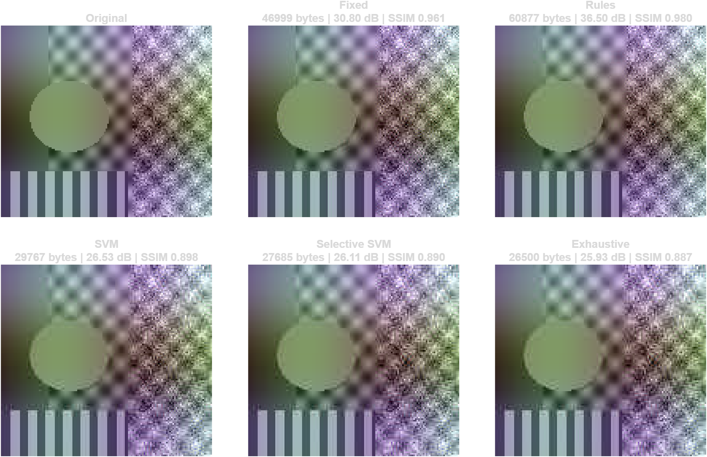

# SVM-OptiCompress

**Dhanush Naidu · Amrita Vishwa Vidyapeetham**

22MAT220 · Mathematics for Computing III · End-semester group project

How should an image encoder spend a limited budget for checking its decisions? This MATLAB project predicts a compression setting for each 8 × 8 block, then tries all three settings on the quarter of blocks where the SVM scores are closest. Each encoder produces a binary file that can be decoded independently.

**For the current coursework submission, open [Version 2 — Theme A](Version-2-Theme-A/README.md).** Both folders are self-contained.

| Version | What to explore |
|---|---|
| [Version 1](Version-1/README.md) | Five image encoders, a six-image comparison, the selective-review experiment and a standalone decoder. |
| [Version 2 — Theme A](Version-2-Theme-A/README.md) | The original app plus real-image PCA, a custom SVM compared with MATLAB, a CVXOPT quadratic program and a large sparse Conjugate Gradient experiment. |

## Run the demonstration

Download and extract the repository, or clone it with Git. Open MATLAB in the repository root and run:

```matlab
cd('Version-2-Theme-A')
run_project
```

The app opens on **Six-image comparison**. Choose **Image codec → Compress** to see how many predictions were reviewed and changed. Open **Theme A experiments** to inspect the solver results and convergence plots. The saved CVXOPT results are available in the app without launching Python.

Tested with MATLAB R2026a on Windows, Statistics and Machine Learning Toolbox, and Optimization Toolbox. The version guides give the full setup and reproduction commands.

## Results at a glance

- **Compression:** On the gallery sample, selective review reduced the file from 29,767 to 27,685 bytes relative to ordinary SVM, while PSNR fell from 26.53 to 26.11 dB. Across three synthetic test scenes, selective review had lower block cost than equal-budget random review. [Pilot measurements](Version-1/results/metrics/selective_pilot.csv)
- **Optimization:** The custom SVM, MATLAB fit and CVXOPT solution reached primal objectives near 66.94 on the same training problem. Custom CG and MATLAB pcg both reached the specified tolerance in 72 iterations on a system with 196,608 unknowns. [Theme A measurements](Version-2-Theme-A/results/theme_a/)


