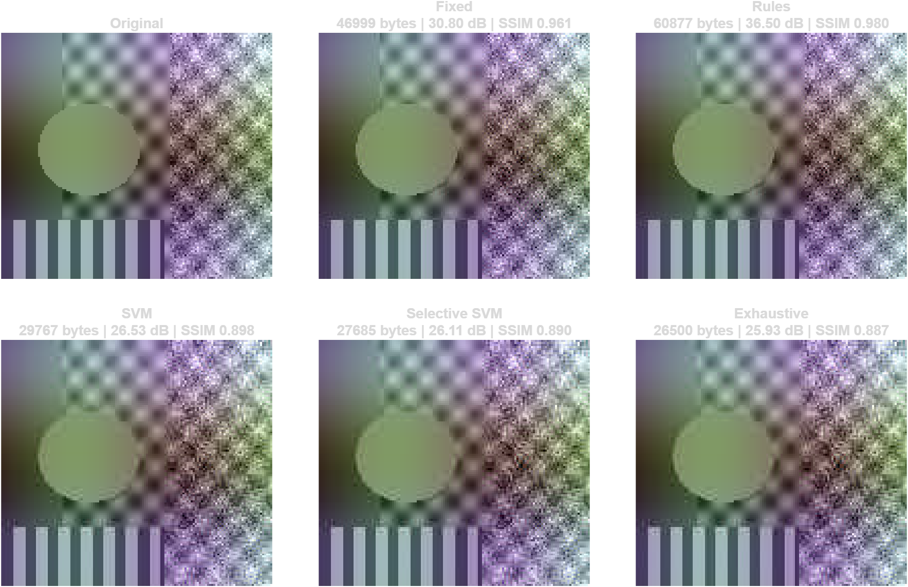

# Version 1 · SVM-OptiCompress

**Project author: Dhanush Naidu**

Amrita Vishwa Vidyapeetham · Mathematics for Computing 3 · End-semester project

SVM-OptiCompress is an offline MATLAB application for exploring how image quality changes as a file gets smaller. It divides a grayscale or RGB image into 8 × 8 blocks and chooses strong, moderate, or light compression for each block. Its **Selective SVM** encoder asks a second question: if the encoder can double-check only a quarter of its predictions, which decisions are worth revisiting?



This folder preserves the original codec implementation and benchmark. Start here to trace a block from prediction to a saved file. For the final uploaded-image and quantum-edge experiments, use [Version 2 · Final](../Version-2-Final/README.md). [Back to the repository overview](../README.md).

## Run the project

**Tested environment:** MATLAB R2026a on Windows, with Statistics and Machine Learning Toolbox for the SVM and k-means, and Optimization Toolbox for the quadratic program. Image Processing Toolbox is optional for SSIM because the project includes a Gaussian-window implementation. The sample data and trained model are included.

1. Choose **Code → Download ZIP** on GitHub and extract it to a writable folder. Alternatively, clone the repository:

   ```sh
   git clone https://github.com/rongalidhanush/SVM-OptiCompress.git
   ```

2. Open MATLAB and select **Version-1** inside the extracted repository as Current Folder. This folder contains the original launcher and setup script.
3. Enter this in the MATLAB Command Window:

   ```matlab
   run_project
   ```

The app runs setup automatically and opens **Six-image comparison** with the original and all five reconstructions. To compare your own photo, go to **Image codec → Upload image**. To see how many predictions the encoder changed, select **Selective SVM** and click **Compress**. Use **Save compressed file**, then **Open compressed file → Decompress**, to demonstrate a complete round trip.

## How the encoder works

1. **Measure each block.** Pad the image edges and extract seven features: mean intensity, standard deviation, variance, edge density, gradient energy, local entropy and high-frequency energy.
2. **Learn the compression labels.** During training, evaluate three quantizers on each block. The label is the setting that minimizes `MSE + 32 × bits per pixel`. Training and testing use separate images.
3. **Select blocks for review.** The SVM scores the three settings. Selective SVM ranks blocks by the gap between their two highest scores and checks the smallest gaps first. It evaluates all three quantizers on the selected quarter at the actual compression level and scale.
4. **Write the file.** Apply the block DCT, quantize the coefficients, scan them in zigzag order and run-length encode them. The binary `.soc` file stores the dimensions, quantization settings, block classes and coefficient records. The decoder can reconstruct the image using only this file and the codec source.

For a code walkthrough, start with [the selective decision](research/selective_quantizers.m), then follow [the encoder](src/compression/compress_image.m) and [the decoder](src/decompression/decompress_image.m).

| Encoder | How it chooses a setting |
|---|---|
| Fixed | Uses the moderate setting for every block. |
| Rules | Applies thresholds to block variation and edge density. |
| SVM | Uses the trained model’s prediction directly. |
| Selective SVM | Measures all three candidate costs for the closest quarter of SVM decisions. |
| Exhaustive | Measures all three candidate costs for every block. |

## Experimental results

The bundled experiment uses **eight synthetic training images** and **three held-out synthetic images**. The classifier matched the lowest-cost label on **70.0% of 734 held-out blocks**. The file benchmark covers **135 encode–decode runs** across five methods and nine compression levels.

The table reports **average excess cost per block**: the chosen setting’s cost minus the best available cost among the three candidates. Lower is better. Random review is the expected cost of reviewing a uniformly selected subset of the same size.

| Held-out image | Blocks reviewed | Ordinary SVM | Random review | Selective SVM |
|---|---:|---:|---:|---:|
| Scene 09 | 56 of 224 | 16.07 | 12.05 | **7.71** |
| Scene 10 | 63 of 255 | 20.11 | 15.14 | **5.00** |
| Scene 11 | 63 of 255 | 14.10 | 10.62 | **6.93** |

Selective review reduced excess cost relative to random review on all three scenes. On the separate RGB gallery sample, it changed **33 of 68 reviewed decisions**. The encoded file shrank from **29,767 to 27,685 bytes** compared with ordinary SVM, while PSNR fell from **26.53 to 26.11 dB**.

Timing tells a different part of the story. Selective SVM averaged **15.8 ms** per encode on the benchmark, while exhaustive search averaged **10.3 ms**. These measurements describe small synthetic images on the test laptop. The compression ratio uses raw 8-bit raster bytes divided by actual encoded bytes. For quality comparisons, use points with similar bits per pixel.

[Review experiment data](results/metrics/selective_pilot.csv) · [All measured operating points](results/metrics/rate_curves.csv) · [Nearest-bitrate comparisons](results/metrics/nearest_rates.csv)

## Mathematics you can demonstrate

| App tab | What to show |
|---|---|
| Block classifier | Inspect the held-out confusion matrix and the compression-class map. |
| Block cost | On the bundled sample’s top-left block, change the rate penalty from 0 to 32. The winning setting changes from light to strong. |
| Optimization & PCA | Solve a separate binary soft-margin SVM with `quadprog`, inspect support vectors and KKT residuals, and project standardized features onto two principal components. |
| Clustering | Group image blocks with k-means and compare cluster counts and average texture features. |
| Spatial transitions | After clustering, inspect the probability of each cluster appearing immediately to the right of another. |
| Rate comparisons | Compare quality, file size and encoding time across the five encoders at nine levels. |

## Reproduce or extend the project

Run these commands from the repository root in MATLAB.

| Command | What it does |
|---|---|
| `setup` | Checks the core toolbox functions, adds source paths and prepares sample and output folders. |
| `run_demo` | Rebuilds compressed streams, reconstructed PNGs, graphs and metric tables under `results/`. |
| `setup; run_selective_pilot` | Prints the equal-budget review comparison shown above. |
| `train_svm_model` | Retrains the classifier and replaces the saved model under `models/`. |
| `run_tests` | Retrains the model and runs nine regression tests, including file decoding, selective review and gallery startup. |

To use a larger dataset, add independent images to `datasets/training/` and `datasets/testing/`. Keep crops and near-duplicates from a scene in the same split, then retrain. The batch benchmark reads PNGs from the testing folder.

**Decode a bundled file independently:**

```matlab
addpath(genpath('src'))
[img, blockClasses] = decompress_image('results/compressed/scene_09.soc');
imwrite(img, 'decoded_scene_09.png')
```

## Documentation

- [Setup, supported image formats and troubleshooting](documentation/setup_guide.md)
- [Feature definitions, binary format and comparison protocol](documentation/algorithms.md)
- [SVM formulation, Lagrange multipliers, KKT conditions and matrix norms](documentation/svm_mathematics.md)
- [Five-minute demonstration and viva questions](documentation/viva_preparation.md)
