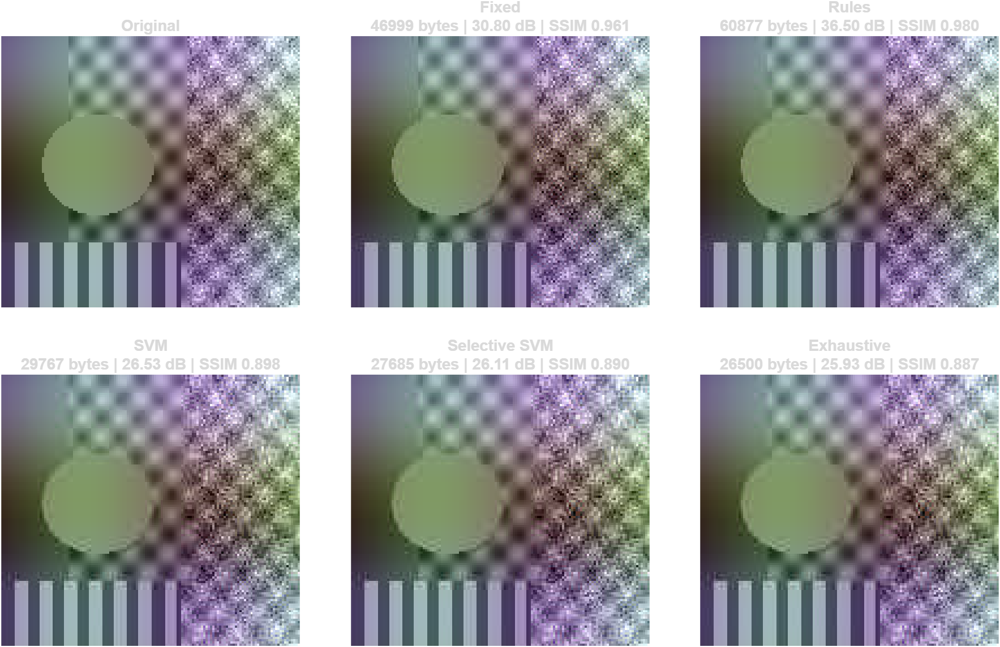
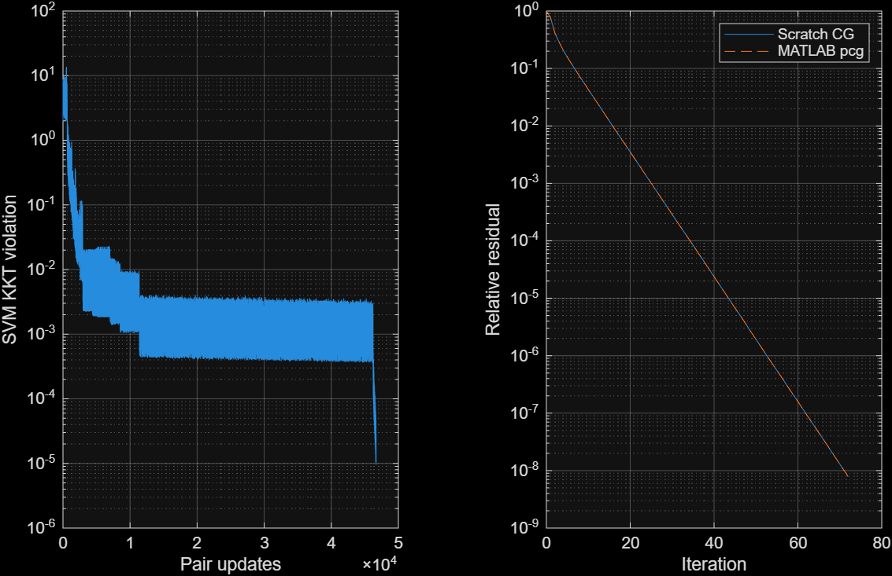

# Version 2 · SVM-OptiCompress for Theme A

**Dhanush Naidu , Keerthan Reddy · Amrita Vishwa Vidyapeetham · 22MAT220**

This is the current Optimization and Machine Learning version. It combines a working adaptive image codec with four reproducible numerical experiments. The codec asks which compression decisions deserve review. The numerical experiments ask how well a low-dimensional feature representation reconstructs held-out data and how closely independent solvers agree on the same mathematical problem.

## Open the app

1. Download and extract the repository to a writable folder. In MATLAB, set **Current Folder** to `Version-2-Theme-A`.
2. Run `run_project`. Tested with MATLAB R2026a on Windows, Statistics and Machine Learning Toolbox and Optimization Toolbox. The project includes an SSIM fallback for installations without Image Processing Toolbox.
3. In **Six-image comparison**, inspect the original and five reconstructions. In **Image codec**, upload an image, select a method and compress. Save the .soc stream and reopen it to demonstrate independent decoding.
4. Open **Theme A experiments**. Choose **Analyze current uploaded image** to run the held-out PCA, SVM, primal QP, CG, and codec comparisons using the image currently loaded in **Image codec**. Results and reconstructed images are saved in a new `results/theme_a/user_runs/<timestamp>_<image-name>/` folder. **Re-run reference benchmark** restores the standard MATLAB example-image run in `results/theme_a/`.

## Follow one block through the compressor

Suppose a photo contains both smooth sky and feathered wings. Rounding away fine detail may save bytes in both places, but the visible error can differ. The encoder makes a local decision for each 8 × 8 block.

1. **Read and partition.** Convert the input to 8-bit grayscale or RGB and repeat the final row or column where padding is needed. Compute seven luminance features per block: mean intensity, standard deviation, variance, edge density, gradient energy, local entropy and high-frequency energy.
2. **Learn three settings.** During training, try strong, moderate and light quantization. Choose the setting that minimizes `J = D + 32R`, where D is mean squared error before final pixel rounding and R is bits per spatial pixel. Stronger quantization can win when its byte savings outweigh the increase in error.
3. **Spend the review budget.** At encoding time the SVM scores the three classes. Selective SVM ranks blocks by the gap between the two largest scores and reviews the smallest gaps. For N blocks it measures all three costs on floor(N/4) blocks. The score gap ranks ambiguity; the measured costs decide whether to change a prediction.
4. **Write and reconstruct.** Apply the DCT, divide coefficients by their quantization steps and round. Scan in zigzag order and encode zero runs and signed coefficients. The binary SOC1 stream carries the dimensions, settings and block classes needed for decoding. The decoder reconstructs pixels from the saved stream and removes padding.



### What the five methods compare

| Method | Decision rule | Question it answers |
|---|---|---|
| Fixed DCT | Use moderate everywhere. | What happens with one setting for the whole image? |
| Rules | Apply thresholds to block variation and edge density. | How well does a simple hand-written policy work? |
| SVM | Use the predicted class directly. | How much can the learned decision save? |
| Selective SVM | Re-evaluate the closest quarter of predictions. | Where is it worth spending extra checks? |
| Exhaustive | Evaluate all three costs for every block. | What is the lowest available block cost at these settings? |

At level 1 and scale 1 on the gallery sample, selective review checked **68 of 272 blocks** and changed **33 decisions**. The stream shrank from **29,767 to 27,685 bytes** versus ordinary SVM, while PSNR fell from **26.53 to 26.11 dB**. These are observations at the same encoder settings. To compare quality at similar *file size*, use the [nearest-bitrate table](results/metrics/nearest_rates.csv).

## Datasets and evaluation protocol

| Experiment | Training or fitting | Evaluation |
|---|---|---|
| Three-class codec | Eight deterministic synthetic training images, with labels measured separately for each block. | Three held-out synthetic images, 734 blocks. Five methods at nine levels give 135 encode–decode runs. |
| Real-image PCA and binary SVM | Blocks from MathWorks sample images `street1.jpg` and `ngc6543a.jpg`. Fit normalization on training rows. For the binary SVM, take up to 100 blocks per extreme class. | Use the whole held-out `peppers.png` image for PCA reconstruction. For the binary test, retain blocks labeled strong or light. |
| Image smoothing by CG | Build the sparse linear system from the red channel of the peppers image. | Compare the custom solver against MATLAB pcg with the same zero initial guess and residual tolerance. |

The synthetic scenes are included in [datasets](datasets/). MATLAB supplies the reference real sample images; the [exported features](results/theme_a/real_blocks.csv) let readers inspect the standard measurements used by the course experiments. A custom uploaded photo is used as a scene-level held-out image while the two reference images remain the training set. This avoids fitting and evaluating on the same photo. The original benchmark files are preserved; each custom run receives its own timestamped folder.

## Mathematics behind the four experiments

**PCA.** Standardize the training features, form their sample covariance matrix and sort its eigenvectors by decreasing eigenvalue. Project each held-out feature vector onto the first k directions, then project back. Training variance retained and held-out relative Frobenius error answer different questions. At k = 3 the training variance retained is 91.99%, whereas the held-out relative error is 0.3265. This experiment reconstructs feature vectors; the codec reconstructs image pixels with the inverse DCT.

**Soft-margin SVM.** The primal objective is ½‖w‖² + CΣξᵢ, subject to yᵢ(wᵀxᵢ + b) ≥ 1 − ξᵢ and ξᵢ ≥ 0. Setting C = 1 fixes the trade-off between margin width and slack. In the dual, changing a pair of multipliers together preserves the equality constraint; clipping the step keeps both within [0,C]. The scratch solver tracks a KKT violation as its stopping criterion. MATLAB fitcsvm provides an independent linear-SVM baseline.

**CVXOPT.** Stack the weights, intercept and slacks into one decision vector. Only the weights receive a quadratic penalty, so the Hessian is positive semidefinite. CVXOPT solves the resulting constrained quadratic program using the same exported features and labels. Compare objective value, feasibility and duality gap before interpreting test accuracy.

**Conjugate Gradient.** Let D compute adjacent pixel differences and f be the input red channel. Minimizing ½‖u−f‖² + 4‖Du‖² gives the system (I + 8DᵀD)u = f. Its matrix is symmetric positive definite because vᵀMv = ‖v‖² + 8‖Dv‖² is positive for every nonzero v. This permits CG to solve the sparse system without forming a dense inverse. The reported residual is ‖Mu−f‖/‖f‖.


## Four experiments and their evidence

| Method | Setup and measured result |
|---|---|
| [Real-image PCA](results/theme_a/pca.csv) | Fit scaling and covariance on street and nebula images. Three PCs retain 91.99% of training variance. On the held-out peppers image the relative feature reconstruction error is 0.3265 with three PCs and 0.0910 with five. |
| [SVM from scratch](results/theme_a/svm.csv) | A dual pair-update solver preserves the label-balance constraint and clips updates to the box constraints. On identical scaled training rows, its primal objective is 66.93635 versus 66.94048 for linear fitcsvm. |
| [Constrained convex optimization](results/theme_a/cvxopt.csv) | CVXOPT solves the same soft-margin primal with affine margin and slack constraints. It reports optimal in 13 iterations, with objective 66.93627 and duality gap 9.76 × 10⁻⁶. |
| [Krylov method](results/theme_a/cg.csv) | A sparse positive-definite pixel-smoothing system has 196,608 unknowns. Custom CG and MATLAB pcg both take 72 iterations. The recomputed relative residual is 7.86 × 10⁻⁹. |

The binary held-out split contains 3,050 strong-compression blocks and one light block. Always predicting strong also achieves 99.97% accuracy. The comparison therefore supports **agreement between solvers**; minority-class performance needs more evidence. The desktop codec’s 70% classifier result comes from a separate three-class synthetic benchmark.



## Reproduce the results

From this version folder, run the standard reference benchmark in MATLAB:

```matlab
run_theme_a
```

With no argument, the script locates the two MathWorks training images and the standard `peppers.png` held-out image, computes seven features per block, exports the training and test matrices, and writes PCA, SVM, MATLAB `quadprog`, CG, and codec results under `results/theme_a/`. The saved [block dataset](results/theme_a/real_blocks.csv) records the source image, block index and compression label.

To run Theme A on the image currently shown in the app, use **Theme A experiments → Analyze current uploaded image**. The same operation is available from MATLAB with a path:

```matlab
run_theme_a('C:\\path\\to\\your\\photo.jpg')
```

The custom image becomes the held-out scene; training and feature scaling remain based on `street1.jpg` and `ngc6543a.jpg`. The run is saved separately under `results/theme_a/user_runs/` and includes `pca.csv`, `svm.csv`, `quadprog.csv`, `cg.csv`, convergence/PCA plots, a six-panel compression comparison, per-method reconstructions, compression metrics, and a copy of the input image. For very large photos, the CG smoothing demonstration downsamples its working image to at most 800 pixels on the longest side; the compression and block-feature experiments use the uploaded image at its original dimensions.

If CVXOPT is installed, you can add its solver result to that custom run by passing the run folder to the Python script:

```sh
python theme_a_cvxopt.py "results/theme_a/user_runs/<timestamp>_<image-name>"
```

Then, from a terminal in the **same folder**, run:

```sh
python -m pip install numpy cvxopt==1.3.2
python theme_a_cvxopt.py
```

The Python solver uses the exported MATLAB matrices and writes its measurements to `results/theme_a/cvxopt.csv`. Python is required only for reproducing that solve.

| Other MATLAB command | Output or purpose |
|---|---|
| `run_demo` | Regenerates the five-method compression benchmark, decoded images and plots. |
| `setup; run_selective_pilot` | Compares selective, ordinary SVM and expected random-review costs on the same images. |
| `train_svm_model` | Retrains and replaces the stored three-class codec model. |
| `run_tests` | Runs the compression project’s regression suite, including its gallery startup check. |

## Five-minute demonstration

1. Open **Six-image comparison**. Point out the original, the five decoded outputs and the measured bytes under each image.
2. On the bundled sample, open **Block cost**, choose row 1 and column 1, and change the rate penalty from 0 to 32. Explain why the minimum moves from light to strong.
3. Open **Image codec**, choose **Selective SVM** and compress. Distinguish blocks *reviewed* from decisions *changed*. Save and reopen the stream to show independent decoding.
4. Switch to **Theme A experiments**. Show the PCA error at three versus five components, compare the three SVM objectives, then show how the CG residual falls across iterations.
5. End with the limitation: the binary test is heavily imbalanced, and the synthetic codec benchmark did not show a speedup over exhaustive search. The [pilot data](results/metrics/selective_pilot.csv) support a narrower finding: selective review gave lower excess cost than equal-budget random review on all three synthetic test scenes.

### If a command does not work

- **MATLAB cannot find run_project:** check `pwd`. The Current Folder should contain both `run_project.m` and `run_theme_a.m`.
- **The app opens without the Theme A tab:** close the old window and run `which run_project -all`. Select the Version 2 folder and launch the app again.
- **Python cannot import cvxopt:** use the same Python executable for the pip install and the solver command. If input CSVs are missing, run `run_theme_a` in MATLAB first.
- **Need to preserve earlier measurements:** use a separate working copy before regenerating outputs or retraining. The batch scripts reuse the named result files.


## Read the implementation

Start with [the MATLAB experiments](run_theme_a.m) and [the CVXOPT primal](theme_a_cvxopt.py) for the course methods. For the compression algorithm, follow [the block review policy](research/selective_quantizers.m), [encoder](src/compression/compress_image.m) and [decoder](src/decompression/decompress_image.m). The [Theme A guide](documentation/theme_a.md) explains the equations, data split, convergence tests and rubric mapping. The [codec specification](documentation/algorithms.md) explains file layout and metric definitions.

[Repository overview](../README.md) · [Original compression project](../Version-1/README.md)
